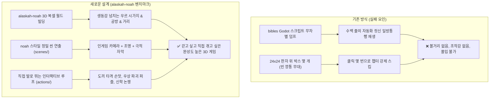

# 아브라함 (Abraham) — 전 6권 전면 재설계 마스터 플랜

> **핵심 전환 원칙**:
> 1. **비주얼과 게임플레이의 절대 기준 = `alaskah-noah`**: 
>    - 빈 바닥에 네모 상자 몇 개 얹은 깡통 무대를 완전히 걷어내고, `alaskah-noah` 수준의 **생동감 넘치고 디테일한 3D 복셀 월드(`TD=16`)**를 전 권에 걸쳐 구축한다.
>    - 플레이어가 아브라함(및 게스트 주인공)이 되어 **직접 거리를 걷고, 제단을 쌓고, 적진을 기습하고, 언약을 체결하는 능동적인 Cozy 3D 내러티브 어드벤처**로 완성한다.
> 2. **풀 사운드 스케이프 연출 (BGM 22곡 / Ambience 14곡 / SFX 15개 범주 / 절차적 음성 블립)**:
>    - 장면별 감정 곡선에 맞춘 동적 BGM 크로스페이드 및 고유 앰비언스 레이어링.
>    - 인물별 고유 오실레이터 주파수(Hz) 타이프라이터 음성 발음.
> 3. **진행 상태**:
>    - **제1권 · 불과 팥죽 (`abraham_1`, 13개 챕터)**: 노아 방주 출항 프롤로그 보강 및 A급 전면 개선 완료.
>    - **제2권 · 약속의 땅 (`abraham_2`, 9개 챕터)**: 세겜/벧엘, 애굽 세관, 318 사병 호바 야간 기습, 멜기세덱 축복 완료.
>    - **제3권 · 별과 언약 (`abraham_3`, 6개 챕터)**: 마므레 상수리, 횃불 언약, 브엘라해로이 하갈, 이스마엘 활쏘기, 할례와 새 이름 완료.
>    - **제4권 · 소돔의 불 (`abraham_4`, 5개 챕터)**: 마므레 세 천사 영접, 의인 열 명 중보, 소돔 폭도 눈멂, 소금 기둥 탈출 완료.
>    - **제5권 · 모리아 (`abraham_5`, 8개 챕터)**: 브엘세바 맹세 우물, 에셀나무, 모리아 사흘 길, 아케다 결박, 여호와 이레 숫양 완료.
>    - **제6권 · 막벨라 (`abraham_6`, 7개 챕터)**: 사라 별세, 에브론 은 400세겔 매입, 막벨라 굴, 나홀 우물가 리브가, 황혼 만남, 아브라함 안식 완료.
>    - **아우트로 (`99_story_outro`)**: 막벨라 회고 및 열국의 아비 영원한 유업 완성.
>    - **전 6권 50개 챕터 구현율 100% 달성 완료**.

---

## 0. 전 6권 통합 마스터 설계서 참조
상세한 전 6권 50개 챕터 서사, 3D 무대 설계, BGM/Ambience/SFX 매트릭스, 인물별 보이스 주파수 표는 [`docs/MASTER_PLAN_ALL_BOOKS.md`](./docs/MASTER_PLAN_ALL_BOOKS.md)를 참조한다.

---

## 1. 문제 분석 및 아키텍처 개혁

### 무엇을 버리고 무엇을 가져오는가?
- **버리는 것**:
  - `data/books/abraham_*.json`에 들어있던 기계적 컷신 스텝 자동 재생 구조
  - `stageManager.ts`의 휑한 단색 바닥과 벽 몇 개짜리 깡통 지오메트리
  - 조작권 없이 텍스트만 주루룩 흐르는 더미 인형극
- **가져오는 것 (`alaskah-noah` 계승)**:
  - `alaskah-noah`의 **`village.ts` / `props/` 라이브러리 확장**: 흙벽돌 가옥, 골목길, 지그라트 원경, 야자수, 토기 항아리, 작업대, 화덕, 횃불 등 공간 밀도 10배 상향
  - `alaskah-noah`의 **`scenes/` 컷신 패턴**: `playIntro`, `playCalling`처럼 극적 순간에만 부드러운 카메라 무빙, 조명 틴트, 빛기둥(`Beam`), 금빛 신의 음성 자막(`style: 'voice'`)으로 연출
  - `alaskah-noah`의 **대화/선택지 시스템 (`talk.ts`)**: 초상화 + 타이프라이터 대화창 + 분기 선택지
  - `alaskah-noah`의 **`story.ts` 상태 머신**: 명확한 퀘스트 단계(`phase`)와 목적지 안내(`hud.goal`)

---

## 2. 제1권 · 불과 팥죽 (`abraham_1`) 재설계 상세

제1권은 총 **7개의 유기적인 챕터**와 **1개의 코다(에필로그)**로 구성되며, 플레이어가 직접 탐험하고 해결하는 어드벤처 구조를 갖춘다.

| 장 | 챕터명 | 플레이 유형 | 핵심 연출 및 상호작용 (`alaskah-noah` 기준) |
|---|---|---|---|
| **Ch.1** | **프롤로그: 바벨과 우르** | 컷신 (`playPrologue`) | - 태고의 밤하늘과 거대 바벨탑 붕괴의 잔상 (`toVista` 원경) - 신이 되고자 한 니므롯의 제국과 갈대아 우르의 번영 자막 연출 - 자연스럽게 청년 아브람의 공방 안마당으로 카메라 착지 |
| **Ch.2** | **우르의 아침과 데라의 공방** | **Playable Hub (탐험)** | - **[우르 시가지 & 공방]** 청년 아브람 직접 조작 - 흙벽돌 골목, 작업대, 토기 항아리, 분주한 장터 구경 - 아버지 데라(우상 제작 장인), 조카 어린 롯, 사래와의 대화 - 고객과의 대화 선택지 ("이 우상이 정말 우리를 지켜줄까요?") |
| **Ch.3** | **밤하늘의 첫 부르심** | Hybrid (`playNightCalling`) | - 늦은 밤, 잠들지 못하고 옥상 테라스로 올라간 아브람 - 별이 쏟아지는 밤하늘을 올려다보는 순간, 하늘에서 쏟아지는 황금빛 빛기둥(`Beam`) - 여호와의 첫 부르심 음성 (사도행전 7:2-3, 금빛 자막) |
| **Ch.4** | **도끼와 우상 파괴** | **Playable Loop (핵심 퍼즐)** | - **[핵심 손맛 루프: 우상 파괴]** - 작업대에서 묵직한 도끼를 집어 듦 (`hasAxe`) - 말도 못 하고 밥도 못 먹는 작은 우상 3개를 차례로 타격 파괴 (복셀 파편 비산 + 둔탁한 타격 SFX + 모루 흔들림) - 가장 큰 중앙 우상의 손에 도끼를 쥐여주는 미드라시 퍼즐 완성 - 이튿날 아침 경악한 데라와의 명논리 문답 ("큰 우상이 작은 놈들을 다 부수었습니다!") |
| **Ch.5** | **니므롯의 궁정과 논쟁** | **Playable Quest** | - 분노한 데라에게 이끌려 니므롯의 웅장한 왕궁으로 이동 - 푸른 이슈타르 타일 기둥과 옥좌 위의 니므롯 대면 - 니므롯과의 심문 대화 선택지:   *"불을 섬기라" → "물을 섬기오리까?" → "구름을 섬기오리까?"* - 격노한 니므롯의 풀무불 투옥 선언 |
| **Ch.6** | **풀무불의 기적** | Hybrid (`playFurnace`) | - **[풀무불 광장]** 거대한 원형 복셀 화로와 치솟는 화염 파티클 - 불 속에 던져진 아브람. 그러나 털끝 하나 상하지 않고 천사와 함께 화로 안을 거니는 클라이맥스 연출 (`tint: 'fire'` → 황금빛 안도) - 기적에 압도되어 공포에 질린 니므롯과 군중들 |
| **Ch.7** | **우르 탈출과 하란 정착** | **Playable Escape & Journey** | - 풀무불에서 살아 돌아온 아브람. 식구들을 챙겨 짐을 꾸림 (봇짐 챙기기 루프) - 데라, 사래, 롯을 이끌고 우르 성문을 빠져나와 북쪽 하란으로 출발 (`TravelMap` 여정) - 하란 캠프 도착, 기력이 다한 아버지 데라의 임종과 애도 - "이제 내가 네게 보여줄 땅으로 가라"는 부르심의 완성을 향한 결의 |
| **Coda** | **에필로그: 에서와 붉은 팥죽** | Hybrid (게스트 시점) | - *[시대 전환: 먼 훗날 가나안 장막]* - 들판에서 사냥에 지쳐 굶주린 채 돌아온 에서 직접 조작 - 야곱이 장막 앞에서 끓이고 있는 붉은 팥죽 냄비와 상호작용 - 장자권을 넘기는 비극적 대화 선택지와 팥죽 한 그릇의 결착 |

---

## 3. 세부 제작 로드맵 (제1권 집중 5단계)

### Step 1: 우르 시가지 & 공방 3D 복셀 월드 전면 구축 (`world/stages/ur.ts`)
- `alaskah-noah`의 `village.ts` 수준으로 환경 밀도 대폭 상향:
  - 흙벽돌 바닥 타일링, 골목길 경계선, 배수로
  - 데라의 공방 본채(작업대, 진열 선반, 끌과 망치, 흙 반죽통)
  - 옥상 테라스 및 계단 (밤하늘 별을 보는 장소)
  - 공방 앞 골목과 시장 가판대(곡물 자루, 토기 항아리, 양탄자, 과일 바구니)
  - 원경의 거대 복셀 지구라트 실루엣과 종려나무(야자수) 숲

### Step 2: 1권 전용 `Story` 상태 머신 및 씬 연출 시스템 (`systems/story.ts`, `systems/scenes/book1/`)
- 기존의 복잡한 덤프 엔진을 버리고, 노아처럼 직관적인 `Book1Phase` 상태 머신 정립:
  - `'prologue' | 'workshop' | 'calling' | 'the_axe' | 'nimrod_palace' | 'furnace' | 'escape_haran' | 'coda_esau'`
- `scenes/book1/` 아래 명확한 연출 함수 작성:
  - `playPrologue()`: 바벨탑의 오만과 우르 전경
  - `playNightCalling()`: 옥상에서 별 헤기 + 빛기둥 + 황금 자막 부르심
  - `playFurnace()`: 풀무불 투하 및 천사와의 동행 컷신
  - `playHaran()`: 하란 도착 및 데라의 평안한 안식

### Step 3: 공방 상호작용 및 우상 파괴 액션 루프 (`systems/actions/urActions.ts`)
- 조작감과 피드백 강화:
  - 공방 안의 물건 조사 (선택지 대화창)
  - 도끼 줍기 (`pickupAxe`)
  - 작은 우상 3개 타격 파괴: E키 누를 때마다 도끼 휘두르는 복셀 모션 + 복셀 돌/나무 파편 파티클(`ParticleManager`) 비산 + 둔탁한 타격음 SFX
  - 큰 우상에게 도끼 꽂아 넣기 퍼즐
  - 데라와의 아침 대화 ("누가 감히 신상들을 부수었느냐!")

### Step 4: 니므롯 왕궁과 풀무불 광장 구현 (`world/stages/urPalace.ts`, `urFurnace.ts`)
- 니므롯 왕궁: 이슈타르 청유리 타일 기둥, 옥좌, 근위병 복셀 액터들, 대화 선택지 분기
- 풀무불 광장: 지름 8유닛의 거대 복셀 원통형 가마, 내부의 붉은 불꽃과 열기 디더링, 군중 액터 배치

### Step 5: 하란 여정 및 팥죽 코다, 그리고 헤드리스 브라우저 QA
- 하란 천막 캠프와 데라의 임종 장면
- 에서 시점 팥죽 상호작용
- Puppeteer 기반 자동 플레이 및 스크린샷 캡처 검증 (10점 만점 8.5점 이상 달성)

---

## 4. 즉각 실행 작업 순서

1. **Step 1 착수**: `src/world/stages/ur.ts` 작성 (우르 시가지 & 데라 공방 고밀도 복셀화)
2. **Step 2 착수**: `src/systems/scenes/book1/` 및 `story.ts` 씬 파이프라인 정리
3. **Step 3 착수**: 도끼 우상 파괴 루프 및 공방 인터랙션 구현
4. **Step 4 착수**: 니므롯 왕궁 & 풀무불 씬 구현
5. **Step 5 착수**: 하란 이동 및 QA 검증
