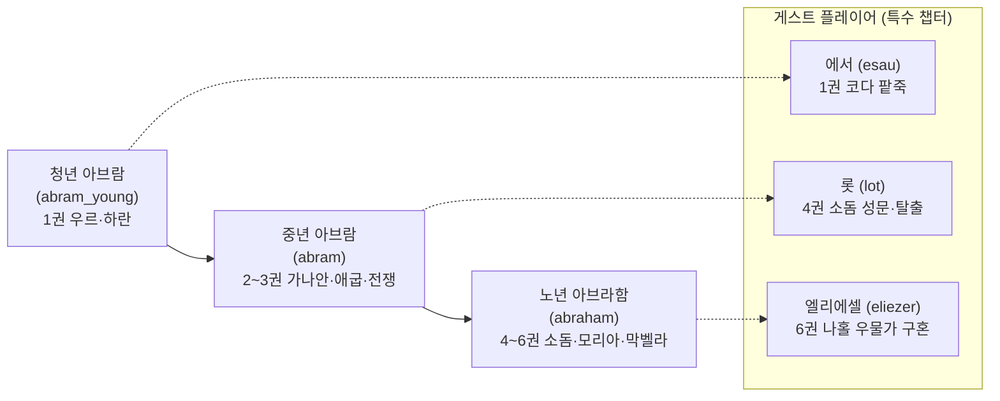
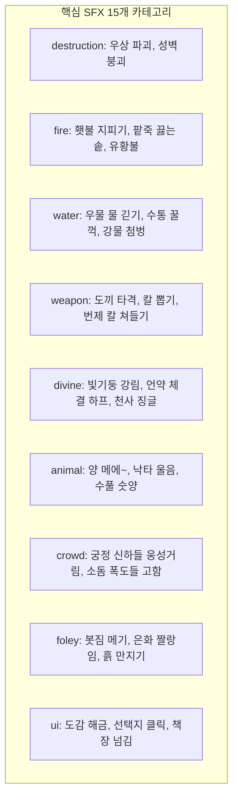

# 아브라함 (Alaskah Abraham) — 전 6권 통합 마스터 설계서
> **부제**: 전 6권(50개 챕터) 3D 복셀 월드 빌딩, 게임플레이 루프, 서사/미드라시 연출, 배경음(BGM) 및 효과음(SFX) 통합 아키텍처

---

## 1. 총괄 아키텍처 및 핵심 원칙

### 1.1 프로젝트 목표 및 비주얼 기준
* **기준 모델**: `alaskah-noah` 수준의 **생동감 넘치고 밀도 높은 3D 복셀 월드(`TD=16`, VoxelBuilder)** 및 **능동적인 Cozy 3D 내러티브 어드벤처**.
* **규모**: 인트로 + 전 6권(46장) + 아우트로 = 총 50개 챕터 완결 구조.
* **성경과 미드라시의 조화**: 창세기 9~25장 원문 서사를 뼈대로, 유대 탈무드(Talmud), 미드라시 라바(Midrash Rabbah), 야샬의 책(Book of Jasher), 요세푸스(Josephus) 유대고대사 전승을 유기적인 인게임 퀘스트와 컷신으로 승화.

### 1.2 주인공 시점 전환 매트릭스 (Multi-Protagonist)

---

## 2. 통합 사운드 아키텍처 (Master Sound Architecture)

### 2.1 BGM 트랙 매핑 (22 Tracks)
모든 음악은 감정 곡선과 무대 분위기에 맞춰 동적으로 크로스페이드(Fade 1.5s) 전환됩니다.

| 트랙 ID | 파일명 | 템포 / 무드 | 주요 매핑 장면 |
|---|---|---|---|
| **BGM 01** | `bgm_intro` | 웅장함, 태고의 서막 | 게임 타이틀 오프닝, 태고의 계보 |
| **BGM 02** | `bgm_ancient_memory` | 신비로움, 고대 하프 | 노아의 홍수 회상, 바벨탑의 잔상 |
| **BGM 03** | `bgm_nimrod_empire` | 위압적, 군악 타악기 | 니므롯 황궁, 바로의 애굽 궁정 |
| **BGM 04** | `bgm_family_warmth` | 따뜻함, 어쿠스틱 현악 | 데라의 공방 일상, 사라와 아브라함의 장막 |
| **BGM 05** | `bgm_tension` | 긴장, 묵직한 베이스 | 우상 파괴 직전, 롯 목자와의 갈등 |
| **BGM 06** | `bgm_judgment_fire` | 파멸, 휘몰아치는 금관 | 7배 풀무불, 소돔과 고모라 유황불 심판 |
| **BGM 07** | `bgm_lament` | 애도, 애절한 피리 | 데라의 임종, 하갈의 광야 통곡, 사라의 장례 |
| **BGM 08** | `bgm_nomad_journey` | 경쾌한 방랑, 카라반 | 하란 출발, 가나안 방랑, 엘리에셀 대상단 |
| **BGM 09** | `bgm_covenant_stars` | 숭고함, 밤하늘 하모니 | 옥상 별들의 묵상, 횃불 언약 |
| **BGM 10** | `bgm_peaceful` | 평온, 바람과 플루트 | 세겜 첫 제단, 브엘세바 우물터 |
| **BGM 11** | `bgm_shadow_intrigue` | 은밀함, 불길한 현악 | 애굽 국경 세관, 그랄 왕 아비멜렉의 눈길 |
| **BGM 12** | `bgm_travel` | 진취적, 발걸음 리듬 | 벧엘 언덕길 오르기, 가나안 종단 여정 |
| **BGM 13** | `bgm_battle_deliverance` | 박진감, 빠른 북소리 | 싯딤 골짜기 전투, 호바 야간 기습 구출전 |
| **BGM 14** | `bgm_divine` | 거룩함, 천상의 합창 | 멜기세덱의 축복, 할례 언약, 천사의 음성 |
| **BGM 15** | `bgm_pastoral_home` | 목가적, 온화한 리라 | 마므레 상수리 장막, 목자들의 평화 |
| **BGM 16** | `bgm_danger_pursuit` | 긴박함, 추격전 템포 | 소돔 성 탈출 전력 질주, 광야 추격 |
| **BGM 17** | `bgm_tragedy` | 충격, 비극적 오보에 | 롯의 아내 소금기둥, 연기만 남은 평야 |
| **BGM 18** | `bgm_desert_exile` | 건조함, 쓸쓸한 바람 | 브엘세바 광야로 쫓겨난 하갈과 이스마엘 |
| **BGM 19** | `bgm_feast_celebration` | 환희, 탬버린과 춤 | 이삭 출생 잔치, 리브가 결혼 축제 |
| **BGM 20** | `bgm_sacred_trial` | 묵직한 결의, 슬픔과 순종 | 모리아 산 3일 길, 이삭 번제 결박(아케다) |
| **BGM 21** | `bgm_hope_legacy` | 벅찬 감동, 찬란한 현악 | 막벨라 굴 매장, 이삭과 리브가의 만남, 완결 |
| **BGM 22** | `bgm_divine_call` | 부르심, 영적 울림 | 마므레 세 천사 영접, 소돔 중보 기도 |

---

### 2.2 환경음(Ambience) 매핑 (14 Loops)
무대 진입 시 무한 루프로 재생되며, 공간의 입체감을 부여합니다.

* `amb_city_ur`: 갈대아 우르 시가지 시장의 웅성거림, 상인들의 외침, 먼 당나귀 소리
* `amb_workshop`: 공방의 망치질, 가마의 장작 타는 소리, 끌로 돌을 쪼는 소리
* `amb_palace`: 니므롯 / 바로 궁정의 높은 천장 잔향, 대리석 회랑의 발자국 공명
* `amb_furnace`: 풀무불의 거대한 불꽃 으르렁거림, 작열하는 열풍
* `amb_river`: 나일강 강물 출렁임, 갈대 흔들리는 소리, 물새 소리
* `amb_tent`: 장막 천이 바람에 펄럭이는 소리, 가죽 끈 삐걱임
* `amb_well`: 우물가 도르래 밧줄 삐걱임, 깊은 물소리, 낙타 거친 숨소리
* `amb_field_day`: 가나안 들판의 한낮 햇살, 건조한 산들바람, 매미/풀벌레 소리
* `amb_field_night`: 가나안 언덕의 서늘한 밤바람, 귀뚜라미 소리, 먼 늑대 울음
* `amb_desert_day`: 광야의 휘몰아치는 건조한 모래바람, 뙤약볕의 열기
* `amb_desert_night`: 사막의 싸늘한 냉기, 황량한 밤바람 소리
* `amb_battlefield`: 전투 후의 메마른 바람, 먼 곳의 군호와 쇠붙이 울림
* `amb_cave`: 막벨라 굴 암벽의 습한 울림, 똑똑 떨어지는 물방울 소리
* `amb_fire_aftermath`: 소돔 멸망 후 풀풀 날리는 재, 잦아드는 연기와 유황불 잔향

---

### 2.3 효과음(SFX) 카테고리 및 인게임 트리거 매핑
`AudioManager.playSfx(key)`로 호출되며 액션과 연출에 즉각 반응합니다.

---

### 2.4 인물별 타이프라이터 음성 블립 주파수 (Procedural Voice Blips)
Web Audio API 실시간 오실레이터를 통해 대사 타이핑 시 인물의 성격과 연령을 반영하는 고유 주파수를 발음합니다.

* **하나님 / 천사 (God / Angel)**: 130 Hz (낮고 장엄한 깊은 베이스 사각파)
* **니므롯 (Nimrod)**: 160 Hz (거칠고 위압적인 저음 톱니파)
* **데라 (Terah)**: 210 Hz (노쇠하고 굵은 삼각파)
* **아브라함 노년 (Abraham Elder)**: 240 Hz (온유하고 깊이 있는 사인파)
* **아브람 중년 (Abram Adult)**: 290 Hz (단단하고 신중한 삼각파)
* **청년 아브람 (Abram Young)**: 320 Hz (맑고 곧은 청년톤 사인파)
* **야곱 (Jacob)**: 360 Hz (차분하고 조용한 중고음 삼각파)
* **사래 / 사라 (Sarai / Sarah)**: 480 Hz (품위 있고 우아한 여성 고음 사인파)
* **롯 (Lot)**: 580 Hz (조금 조급하고 떨림 있는 고음 삼각파)
* **하갈 (Hagar)**: 450 Hz (처연하고 슬픈 울림톤 사인파)
* **엘리에셀 (Eliezer)**: 260 Hz (충직하고 정중한 중저음 사인파)
* **리브가 (Rebekah)**: 540 Hz (밝고 생기 넘치는 맑은 고음 사인파)
* **이삭 소년 (Isaac Boy)**: 620 Hz (순수하고 높은 소년톤 사인파)
* **이삭 청년/성인 (Isaac Adult)**: 310 Hz (온순하고 묵상하는 톤 삼각파)
* **에서 (Esau)**: 270 Hz (거칠고 숨 가쁜 들사람 저음 사각파)
* **에브론 (Ephron)**: 220 Hz (느글거리고 계산적인 상인 톤 삼각파)
* **멜기세덱 (Melchizedek)**: 180 Hz (신비롭고 영적인 깊은 공명음)

---

## 3. 권별 상세 설계 (Book-by-Book Deep Dive)

---

### [Intro] 아브라함 · 인트로 (00_story_intro)
* **서사 축**: 태초의 에덴에서 노아의 방주, 그리고 바벨탑에 이르는 인류의 오만과 심판. 밤하늘을 올려다보며 하나님의 구원 역사를 준비하는 도입부.
* **무대**: `ur_workshop` 지붕 테라스 원경 (수평 Vista 틸트 4°).
* **사운드**:
  * BGM: `bgm_intro` → `bgm_ancient_memory`
  * Ambience: `amb_field_night` (밤바람 소리)
  * SFX: `divine_call`, `chime_star`
* **연출**:
  * 어두운 밤하늘에 하나씩 켜지는 황금빛 별자리.
  * 금빛 음성 자막: *"믿음의 조상 아브라함, 갈대아 우르에서 막벨라 굴까지의 위대한 여정."*

---

### [Book 1] 불과 팥죽 (abraham_1, 13개 챕터) — *[구현 완료 & A급 벤치마크]*
* **서사 축**:
  1. **프롤로그 I · 태고의 언약 (000_noahs_curse)**: 대홍수가 끝나고 아라랏 산에 머문 방주에서 노아 가족 여덟 사람이 나옴. 번제단과 무지개 언약, 포도원 사건과 셈을 향한 축복 ("셈의 하나님 여호와를 찬송하리로다! 아브라함은 바로 그 거룩한 셈의 계보").
  2. **프롤로그 II · 바벨탑과 니므롯 (005_tower_of_babel)**: 함의 자손 니므롯의 마음속에 싹튼 반감, 시날 평지 바벨탑 건설과 언어 혼잡 흩으심, 사냥꾼 니므롯의 제국과 우상 숭배의 어둠.
  3. **본편 서사 (010~080)**: 갈대아 우르 데라의 공방, 50세 노인 손님 미드라시, 도끼로 우상 타파, 니므롯 황궁 4단계 신학 변론, 7배 풀무불 속 피어난 장미 정원 기적, 하란 여정 및 데라의 평안한 안식.
  4. **코다 · 에서와 붉은 팥죽 (090~100)**: 사냥에 지친 에서와 야곱의 붉은 팥죽 장자권 거래로 '불과 팥죽'의 수미상관 완결.
* **무대 (4개)**:
  1. `ur_workshop`: 데라의 흙벽돌 공방, 가마, 도끼 작업대, 시장 골목길.
  2. `ur_palace`: 이슈타르 청금석 타일, 8쌍 대리석 원주, 3단 황금 보좌.
  3. `ur_furnace`: 지름 8유닛 원통 풀무불, 화염 파티클, 장미 넝쿨 정원 개화.
  4. `esau_camp`: 가나안 헤브론 붉은 황토, 검은 장막, 삼각대 무쇠솥 붉은 팥죽.
* **사운드**:
  * BGM: `bgm_ancient_memory` (노아 방주), `bgm_nimrod_empire` (바벨탑/궁전), `bgm_family_warmth` (우르 아침), `bgm_tension` (우상 파괴), `bgm_judgment_fire` (풀무불), `bgm_lament` (하란), `bgm_pastoral_home` (팥죽)
  * Ambience: `amb_city_ur`, `amb_palace`, `amb_furnace`, `amb_tent`
  * SFX: `destruction/axe_hit`, `destruction/pottery_break`, `fire/fire_burst`, `fire/stew_bubble`

---

### [Book 2] 약속의 땅 (abraham_2, 9개 챕터)
* **서사 축**: 창세기 12~14장. 하란을 떠나 마침내 약속의 땅 가나안에 발을 디딘 아브람. 기근으로 내려간 애굽에서의 위기와 하나님의 보호, 롯과의 분가, 그리고 싯딤 골짜기 연합군 전쟁에서 롯을 구출하고 살렘 왕 멜기세덱에게 십일조를 바치는 대서사.

#### 챕터 구성
1. `01_the_calling`: 제1장 · 부르심과 세겜 (하란 출발 → 세겜 모레 상수리나무 첫 제단 쌓기)
2. `02_the_chest_at_the_border`: 제2장 · 애굽 국경 — 상자 속의 사래 (미드라시: 보석 상자에 사래를 숨겨 국경을 넘으려다 세관에 발각)
3. `03_sarai_in_egypt`: 제3장 · 애굽의 사래 (바로 궁정의 재앙, 바로의 두려움과 추방)
4. `04_parting_from_lot`: 제4장 · 롯과의 결별 (벧엘 언덕, 양 떼가 많아 목자들의 우물 다툼, 롯에게 선택 양보)
5. `05_shadow_of_nimrod`: 제5장 · 니므롯의 그림자 (엘람 왕 그돌라오멜과 시날 연합군의 가나안 침공 전운)
6. `06_siddim_valley_war`: 제6장 · 싯딤 골짜기의 전쟁 (소돔·고모라 연합군 패배, 아스팔트 구덩이에 빠지고 롯이 포로로 끌려감)
7. `07_war_and_rescue`: 제7장 · 롯 구출 전쟁 (아브람의 사병 318명 소집, 단에서 호바까지 야간 기습 추격전)
8. `08_melchizedek_blessing`: 제8장 · 멜기세덱의 축복 (골짜기에서 떡과 포도주를 들고 나온 지극히 높으신 하나님의 제사장 멜기세덱)
9. `09_shield_and_reward`: 제9장 · 언약의 방패 (소돔 왕의 재물 제안 거절: "네 실 한오라기도 취하지 않겠다", 하나님의 방패 약속)

#### 3D 복셀 무대 설계
* `shechem_bethel` (확장):
  * 세겜 모레 상수리나무 아래 돌 제단 (`buildStoneAltar`), 벧엘과 아이 사이의 가파른 석회암 언덕 전망대.
  * 플레이어가 직접 들판의 거친 돌 4개를 주워 제단을 쌓는 인터랙션 (`build_altar`).
* `egypt` (확장):
  * 나일강 붉은 삼각주 수로, 화려한 이집트 사암 열주 기둥, 국경 세관의 거대한 놋쇠 보석 궤짝.
  * 바로의 황금 궁정: 연꽃 무늬 기둥, 금빛 독수리 옥좌.
* `siddim_hobah` (신규 고밀도 스테이지):
  * 싯딤 역청(아스팔트) 구덩이가 군데군데 솟구친 검은 진흙 골짜기.
  * 호바 야간 협곡: 밤하늘 아래 횃불을 든 318명의 병사들과 적진 텐트 기습 동선.

#### 게임플레이 루프
* **돌 제단 쌓기 퍼즐 (Ch.1)**: 세겜 언덕에서 흩어진 4개의 거룩한 돌을 모아 단을 쌓고 감사 기도 드리기.
* **국경 세관 검문 퍼즐 (Ch.2)**: 사래가 숨은 궤짝의 자물쇠를 풀려는 애굽 관리와의 뇌물/신분 설득 문답.
* **언덕 위 전망 선택 (Ch.4)**: 벧엘 언덕 꼭대기에서 동서남북을 조망하며, 소돔 쪽 기름진 평지를 택한 롯을 축복하며 떠나보내기.
* **야간 기습 어드벤처 (Ch.7)**: 호바 협곡에서 횃불과 나팔을 들고 적진을 3방향에서 포위하여 기습하는 전술적 잠입·추격전.

#### 사운드 스케이프 연출
* BGM:
  * 세겜 도착: `bgm_peaceful` → 벧엘 전망: `bgm_travel`
  * 애굽 국경: `bgm_shadow_intrigue` → 바로 궁정: `bgm_nimrod_empire`
  * 롯 분가 갈등: `bgm_tension`
  * 호바 기습 구출: `bgm_battle_deliverance` (박진감 넘치는 전쟁 북소리)
  * 멜기세덱 축복: `bgm_divine` (신비롭고 영적인 찬가)
* Ambience:
  * `amb_field_day` (가나안 언덕), `amb_river` (나일강변), `amb_battlefield` (싯딤/호바)
* SFX:
  * 돌 쌓는 소리(`sfx_stone_place`), 보석 상자 열리는 소리(`sfx_chest_open`), 칼부림과 야간 함성(`sfx_sword_clash`, `sfx_shout`), 떡과 포도주 잔 부딪침(`sfx_goblet`)

---

### [Book 3] 별과 언약 (abraham_3, 6개 챕터)
* **서사 축**: 창세기 15~17장. 자식이 없어 낙심한 아브람에게 밤하늘의 무수한 별을 보여주시며 언약하시는 하나님. 쪼갠 고기 사이를 지나가는 타는 횃불. 사래의 여종 하갈을 통한 이스마엘의 출생과 갈등, 99세에 받은 할례와 새 이름(아브람→아브라함, 사래→사라), 그리고 웃음.

#### 챕터 구성
1. `01_covenant_of_stars`: 제1장 · 별과 언약 (장막 밖으로 나와 무수한 별을 헤아림, 3년 된 암소·암염소·숫양을 쪼개고 솔개를 쫓음, 타는 횃불의 통과)
2. `02_hagar_and_ishmael`: 제2장 · 하갈과 이스마엘 (임신한 하갈의 사래 멸시, 학대를 피해 도망친 술 길 샘물가에서 천사를 만남: "브엘라해로이")
3. `03_ishmael_of_the_wild`: 제3장 · 이스마엘, 들의 사람 (아브람 장막 주변, 활을 쏘며 거칠게 자라는 소년 이스마엘)
4. `04_circumcision_and_new_name`: 제4장 · 할례와 새 이름 (99세의 아브람에게 나타나신 전능하신 하나님: 열국의 아비 '아브라함', 열국의 어미 '사라')
5. `05_abrahams_laughter`: 제5장 · 아브라함의 웃음 (100세 된 사람과 90세 된 사라가 어찌 낳으리요 하며 엎드려 웃음: "그 이름을 이삭이라 하라")
6. `06_recovery_and_waiting`: 제6장 · 회복과 기다림 (마므레 상수리 수풀 아래 장막에서 온 집안 남자가 언약의 표징인 할례를 행하고 약속을 기다림)

#### 3D 복셀 무대 설계
* `mamre` (헤브론 마므레 상수리 수풀):
  * 거대한 세 줄기 줄기의 마므레 고목 상수리나무(`buildMamreOak`).
  * 아브라함의 큰 검은 장막, 사라의 내실 장막, 양 우리와 가죽 물주머니 건조대.
* `covenant_altar` (횃불 언약 제단):
  * 밤의 들판, 쪼개어 마주 놓은 제물들 사이로 피어오르는 연기 나는 화로와 활활 타는 횃불 오브젝트.
* `beer_lahai_roi` (광야 샘터):
  * 건조한 광야 가운데 솟아난 작은 맑은 샘물과 대추야자 덤불.

#### 게임플레이 루프
* **솔개 쫓기 & 횃불 언약 (Ch.1)**: 제물 고기 위로 내려앉는 사나운 솔개들을 지팡이로 쫓아내며 황혼을 지키는 루프 → 깊은 잠 속에서 타는 횃불이 제물 사이를 지나가는 신비로운 컷신.
* **이스마엘의 활쏘기 (Ch.3)**: 소년 이스마엘이 들판의 표적(짚단)을 활로 쏘는 조작형 미니 인터랙션.
* **할례 언약 의식 (Ch.4~6)**: 부싯돌 칼을 집어 들고 온 집안에 언약의 징표를 선포하는 경건한 의식 진행.

#### 사운드 스케이프 연출
* BGM:
  * 횃불 언약: `bgm_covenant_stars` (극도로 서정적이고 거룩한 테마)
  * 하갈의 광야 방랑: `bgm_desert_exile` → 샘터 천사: `bgm_divine`
  * 할례와 새 이름: `bgm_divine`
  * 마므레 장막의 일상: `bgm_pastoral_home`
* Ambience:
  * `amb_field_night` (별 헤는 밤), `amb_tent`, `amb_desert_day` (하갈 샘터)
* SFX:
  * 솔개 날갯짓과 울음소리(`sfx_bird_cry`), 횃불 타오르는 화르륵 소리(`sfx_torch_burn`), 돌칼 부딪침(`sfx_knife_scrape`), 아기 웃음소리(`sfx_baby_laugh`)

---

### [Book 4] 소돔의 불 (abraham_4, 5개 챕터)
* **서사 축**: 창세기 18~20장. 마므레 상수리나무 아래를 찾아온 세 나그네(하나님과 천사들)를 지극정성으로 대접하는 아브라함과 사라의 웃음. 소돔의 죄악과 멸망을 앞두고 의인 10명을 찾으며 끈질기게 중보 기도하는 아브라함. 롯의 시점으로 체험하는 소돔의 타락과 탈출, 뒤를 돌아보아 소금기둥이 된 롯의 아내. 그랄 왕 아비멜렉 사건.

#### 챕터 구성
1. `01_three_visitors`: 제1장 · 세 나그네 (한낮의 마므레, 장막 문에 앉아 있다가 세 나그네를 발견하고 달려가 발을 씻기고 송아지 요리와 엉긴 젖을 대접함)
2. `02_the_laws_of_sodom`: 제2장 · 소돔의 법 (롯 시점: 소돔 성문에서 두 천사를 영접하여 집으로 들임, 나그네를 유린하려는 소돔 백성들이 문을 부수려 하자 천사들이 그들의 눈을 어둡게 만듦)
3. `03_fall_of_sodom`: 제3장 · 소돔의 멸망 (롯 가족의 긴급 탈출, 소알로 도망, 하늘에서 유황과 불이 비같이 쏟아짐, 뒤를 돌아본 롯의 아내가 소금기둥으로 굳어짐)
4. `04_abrahams_dawn`: 제4장 · 아브라함의 새벽 (마므레 산등성이에서 소돔을 내려다보는 아브라함, 연기가 옹기 가마의 연기처럼 솟아오름)
5. `05_abimelech_and_sarah`: 제5장 · 아비멜렉과 사라 (네게브 그랄 땅으로 이주, 사라를 누이라 하여 아비멜렉이 데려가려 하나 꿈에 경고하신 하나님)

#### 3D 복셀 무대 설계
* `mamre` (오찬 세트):
  * 나무 그늘 아래 평상, 물동이와 대야, 구운 송아지 고기 접시와 버터/우유 잔.
* `sodom` (신규 대규모 타락 도시 무대):
  * 음습하고 화려한 소돔 성벽, 성문 광장, 롯의 벽돌 2층 가옥.
  * 유황불 심판 버전: 하늘이 핏빛 붉은색으로 물들고, 성벽이 무너지며 불타는 유황 덩어리 파티클이 낙하.
  * 언덕길 한편에 우뚝 선 반투명 백색 복셀 '소금기둥(Pillar of Salt)'.
* `gerar` (그랄 블레셋 궁정):
  * 야자수와 흙벽돌 성채, 아비멜렉의 알현실.

#### 게임플레이 루프
* **극진한 손님 대접 루프 (Ch.1)**: 세 나그네 발 씻길 물 길어오기 → 사라에게 고운 가루 세 스아 떡 굽기 지시 → 살지고 좋은 송아지를 잡아 하인에게 건네기.
* **의인 10명 중보 대화 (Ch.1 후반)**: 소돔을 굽어보는 절벽에서 하나님과 6단계 중보 문답 (50명 → 45명 → 40명 → 30명 → 20명 → 10명).
* **소돔 탈출 스릴러 (Ch.3, 롯 시점)**: 눈먼 폭도들을 피해 장모/사위들을 설득하고, 천사의 손에 이끌려 불타는 골목을 전력 질주(Sprint)하여 성문을 탈출.

#### 사운드 스케이프 연출
* BGM:
  * 세 나그네 영접: `bgm_divine_call`
  * 소돔 성문/골목 긴장: `bgm_tension`
  * 소돔 멸망 탈출: `bgm_danger_pursuit` → `bgm_judgment_fire`
  * 소금기둥의 비극: `bgm_tragedy`
  * 새벽의 연기 묵상: `bgm_lament`
* Ambience:
  * `amb_field_day`, `amb_fire_aftermath` (매캐한 유황 연기), `amb_palace` (그랄)
* SFX:
  * 문 두드리는 폭도들의 고함(`sfx_door_bang`, `sfx_angry_crowd`), 눈이 머는 섬광음(`sfx_blind_flash`), 유황불 폭발음(`sfx_meteor_impact`), 소금으로 굳어지는 바스락 소리(`sfx_salt_crystallize`)

---

### [Book 5] 모리아 (abraham_5, 8개 챕터)
* **서사 축**: 창세기 21~22장. 마침내 100세에 태어난 약속의 아들 이삭과 웃음의 잔치. 이스마엘의 희롱과 하갈의 광야 추방, 브엘세바 우물에서의 에셀나무 언약. 그리고 아브라함 신앙의 절대적 정점: "네 사랑하는 독자 이삭을 번제로 드리라." 모리아 산 3일간의 침묵의 여정과 아케다(Akedah, 결박), 수풀에 걸린 숫양의 대속.

#### 챕터 구성
1. `01_birth_of_isaac`: 제1장 · 이삭의 출생 (사라의 웃음: "하나님이 나를 웃게 하시니", 젖 떼는 날의 큰 잔치)
2. `02_ishmael_in_wilderness`: 제2장 · 광야의 이스마엘 (젖먹이 이삭을 희롱하는 이스마엘, 근심하는 아브라함에게 떡과 가죽부대 물을 주어 보냄, 물이 떨어져 통곡하는 하갈과 샘물을 여시는 천사)
3. `03_ishmaels_two_wives`: 제3장 · 이스마엘의 두 아내 (미드라시: 바란 광야로 이스마엘을 찾아간 아브라함, 장막의 평화)
4. `04_well_of_beersheba`: 제4장 · 브엘세바의 우물 (아비멜렉과의 우물 맹세, 암양 새끼 일곱을 주고 우물을 판 권리를 확정, 영원하신 여호와의 이름을 부르며 에셀나무를 심음)
5. `05_satans_accusation`: 제5장 · 사탄의 참소 (천상에서 사탄이 욥기처럼 아브라함의 순종을 시험하자고 참소하는 프롤로그적 계시)
6. `06_road_to_moriah`: 제6장 · 모리아로 가는 길 (아침 일찍 일어나 나귀에 안장을 얹고, 번제에 쓸 나무를 쪼개어 이삭과 두 종을 데리고 3일 길을 걸어감)
7. `07_mount_moriah`: 제7장 · 모리아산 (종들을 산 아래 두고, 이삭에게 번제 나무를 지우고 칼과 불을 들고 동행함. "아버지, 번제할 어린 양은 어디 있나이까?" → "하나님이 자기를 위하여 친히 준비하시리라". 돌단을 쌓고 이삭을 결박하여 칼을 든 순간 하늘에서 울리는 급박한 음성: "아브라함아, 아브라함아! 그 아이에게 손을 대지 말라!")
8. `08_the_road_back`: 제8장 · 돌아오는 길 (수풀에 뿔이 걸린 숫양을 가져다 대신 번제를 드림: "여호와 이레", 벅찬 눈물과 축복을 안고 브엘세바로 귀환)

#### 3D 복셀 무대 설계
* `beersheba` (브엘세바):
  * 깊은 돌 우물(`buildWell`), 푸른 잎을 떨구는 에셀나무(`buildTamarisk`), 평화로운 장막.
* `moriah` (모리아 산악 지형):
  * 산 아래: 두 종과 나귀가 쉬는 베이스캠프.
  * 등산로: 깎아지른 절벽과 거친 암벽 계단, 고산 지대의 마른 관목 숲.
  * 정상 제단: 돌로 쌓은 번제단, 쪼갠 장작더미, 그리고 가시덤불 수풀에 뿔이 얽힌 3D 복셀 숫양(`Ram`).

#### 게임플레이 루프
* **브엘세바 우물 파기와 에셀나무 심기 (Ch.4)**: 돌 우물터를 청소하고 에셀나무 묘목을 심어 물을 주는 평화로운 농경/유목 루프.
* **장작 패기와 짐 꾸리기 (Ch.6)**: 이른 아침, 공방에서 도끼로 번제 나무를 가지런히 패서 나귀에 싣는 묵직한 준비 루프.
* **3일간의 산길 동행과 문답 (Ch.7)**: 이삭과 발을 맞춰 산을 오르며 주고받는 가슴 먹먹한 대화 선택지.
* **칼을 쥐는 떨림의 클라이맥스 (Ch.7)**: 제단 위 이삭을 결박하고 스페이스바/E키로 칼을 쳐드는 순간, 슬로모션과 함께 하늘의 빛기둥이 꽂히며 천사의 음성이 번개처럼 내리꽂힘.
* **수풀의 숫양 찾기 (Ch.8)**: 고개를 들어 뒤편 가시덤불을 조사하여 숫양을 발견하고 제단으로 인도.

#### 사운드 스케이프 연출
* BGM:
  * 잔치: `bgm_feast_celebration`
  * 하갈의 눈물: `bgm_lament` → `bgm_desert_exile`
  * 브엘세바 평화: `bgm_pastoral_home`
  * 모리아 산 3일 여정: `bgm_sacred_trial` (묵직하고 비장한 단조 선율)
  * 칼을 든 순간의 정적: 사운드 음소거(Mute) 후 귓등을 울리는 하이 피치 링잉(Tinnitus) 효과
  * 천사의 부르심과 여호와 이레: `bgm_divine` → `bgm_hope_legacy`
* Ambience:
  * `amb_well`, `amb_desert_day`, `amb_field_night` (산길의 바람)
* SFX:
  * 장작 패는 소리(`sfx_wood_chop`), 나귀 방울 소리(`sfx_donkey_bell`), 번제 칼 뽑는 서늘한 쇳소리(`sfx_blade_draw`), 숫양 울음소리(`sfx_ram_bleat`), 하늘의 천둥 번개 자막음(`sfx_thunder_divine`)

---

### [Book 6] 막벨라 (abraham_6, 7개 챕터)
* **서사 축**: 창세기 23~25장. 127세로 헤브론에서 숨을 거둔 사랑하는 아내 사라를 위한 애도. 헷 족속 에브론에게 정당한 은 400세겔을 달아주고 산 약속의 땅 첫 소유지 '막벨라 굴'. 늙은 종 엘리에셀을 고향 메소포타미아로 보내 이삭의 신부 리브가를 구해오는 신실한 여정. 황혼 들판에서의 이삭과 리브가의 만남, 그리고 175세에 믿음의 선한 싸움을 마치고 조상들에게로 돌아간 아브라함의 평안한 안식.

#### 챕터 구성
1. `01_death_of_sarah`: 제1장 · 사라의 죽음 (기럇아르바 곧 헤브론에서 사라가 별세함, 아브라함이 들어가 슬퍼하며 통곡함)
2. `02_ephrons_bargain`: 제2장 · 에브론의 흥정 (헤브론 성문 어귀, 헷 족속 장로들 앞에서 막벨라 밭과 굴을 사겠다고 간청함, 에브론의 정중한 척하는 흥정에 주저 없이 상인의 통용 은 400세겔을 달아줌)
3. `03_isaacs_comfort`: 제3장 · 이삭의 위로 (어머니를 잃고 브엘라해로이 들판에서 침묵 속에 기도하는 아들 이삭)
4. `04_a_bride_for_isaac`: 제4장 · 이삭의 신부를 구하라 (노년의 아브라함이 가장 늙은 종 엘리에셀을 불러 환도뼈 아래 손을 넣고 맹세하게 함: "가나안 족속의 딸이 아닌 내 고향 내 족속에게로 가라")
5. `05_labans_house`: 제5장 · 라반의 집 (엘리에셀 시점: 낙타 10필에 보물을 싣고 나홀의 성 우물가 도착, "물을 달라 할 때 낙타에게도 마시우게 하는 여인이 주께서 정하신 자니이다", 물동이를 기울이는 어질고 고운 리브가 발견, 금 코걸이와 손목고리 선사, 라반 집에서의 협상과 출발)
6. `06_keturah_and_the_sons_of_the_east`: 제6장 · 그두라와 동방으로 보낸 아들들 (후처 그두라에게서 난 자식들에게 재물을 주어 동방으로 보내고, 모든 소유는 약속의 상속자 이삭에게 줌)
7. `07_death_of_abraham`: 제7장 · 아브라함의 죽음 (175세, 나이가 높아 평안히 열조에게로 돌아감. 이삭과 이스마엘이 손을 잡고 헤브론 막벨라 굴 사라의 곁에 아버지를 정중히 안장함)

#### 3D 복셀 무대 설계
* `hebron_machpelah`:
  * 헤브론 돌 성문 광장(장로들의 좌석), 밭 끝에 위치한 겹동굴 막벨라 굴(`buildMachpelahCave`).
  * 굴 내부: 사라의 석관과 횃불 감실.
* `nahor_well` (메소포타미아 아람나하라임 나홀의 성):
  * 메소포타미아 성벽 원경, 분주한 저녁 우물가, 10마리의 복셀 낙타들이 물을 마시는 대형 석조 물구유.
* `lahairoi_field`:
  * 해 질 녘(황혼 틴트) 이삭이 묵상하며 거니는 가나안 남방 네게브 들판.

#### 게임플레이 루프
* **성문 은화 계량 퍼즐 (Ch.2)**: 양팔저울에 상인들의 무게 추에 맞춰 정확히 은 400세겔을 달아 에브론에게 건네고 매매 증서를 받는 정당한 거래 루프.
* **우물가 기도와 리브가 테스트 (Ch.5, 엘리에셀 시점)**:
  * 우물가에 서서 하나님께 순적한 만남을 구하는 기도.
  * 물동이를 이고 오는 처자에게 다가가 상호작용: 물을 청했을 때 낙타 10마리에게 부지런히 물을 길어 붓는 리브가의 헌신적 애니메이션 감상.
  * 패물 건네기(금 코걸이, 금 팔찌 2개) 인벤토리 상호작용.
* **황혼의 만남 (Ch.5 후반)**: 베일을 쓴 리브가를 낙타에서 내려 영접하는 이삭의 감동적인 황혼 조우.
* **아브라함의 마지막 축복과 장례 (Ch.7)**: 아들 이삭과 이스마엘의 손을 포개어 쥐여주고 숨을 거두는 감동의 마지막 컷신.

#### 사운드 스케이프 연출
* BGM:
  * 사라의 장례: `bgm_lament`
  * 에브론 흥정: `bgm_shadow_intrigue`
  * 엘리에셀 대상단 여정: `bgm_nomad_journey`
  * 우물가 리브가 만남: `bgm_peaceful` → `bgm_divine`
  * 황혼의 조우: `bgm_hope_legacy`
  * 아브라함의 안식과 에필로그: `bgm_hope_legacy` (장엄하고 평안한 오케스트라 피날레)
* Ambience:
  * `amb_cave` (막벨라 굴), `amb_well` (나홀 우물가 낙타 구유), `amb_field_night` (황혼 들판)
* SFX:
  * 은화 짤랑거리는 소리(`sfx_coins_jingle`), 물동이 물 따르는 소리(`sfx_water_pour`), 낙타 물 마시는 소리(`sfx_camel_drink`), 동굴 속 슬픈 발자국(`sfx_cave_footstep`)

---

### [Outro] 아브라함 · 아우트로 (99_story_outro)
* **서사 축**: 아브라함의 일생을 회고하며, 하늘의 별처럼 바닷가의 모래처럼 번성할 그의 영적 후손들(모든 믿는 자들)을 향한 축복의 선언.
* **무대**: 막벨라 언덕 위에서 내려다보는 가나안 땅의 장엄한 전경 (Vista 4° 수평 카메라).
* **사운드**:
  * BGM: `bgm_hope_legacy` (풀 코러스 합창)
  * Ambience: `amb_field_day`
  * SFX: `divine_call`, `chime_star`
* **연출**:
  * 게임을 플레이하며 해금한 46개 장의 발자취와 도감 카드들이 별자리처럼 스쳐 지나감.
  * 최종 엔딩 크레딧 롤.

---

## 4. 권별 3D 무대 및 에셋 제작 로드맵 (Production Matrix)

| 권 | 신규 전용 3D 무대 모듈 | 주요 프롭 & 동물 | 핵심 시스템 & 미니루프 |
|---|---|---|---|
| **Book 1** | `ur.ts`, `urPalace.ts`, `furnace.ts`, `esauCamp.ts` *(완료)* | 큰 우상, 가마, 도끼, 팥죽 솥, 청금석 기둥 | 도끼 우상 파괴, 신학 변론, 팥죽 거래 |
| **Book 2** | `shechemBethel.ts`, `egypt.ts`, `siddimHobah.ts` | 돌 제단, 상수리나무, 나일강, 보석 상자, 역청 구덩이 | 제단 돌 쌓기, 세관 검문 문답, 호바 야간 기습 |
| **Book 3** | `mamreCamp.ts`, `covenantAltar.ts`, `lahairoi.ts` | 쪼갠 고기 제단, 타는 횃불, 활과 과녁, 샘터 | 솔개 쫓기, 횃불 컷신, 소년 이스마엘 활쏘기 |
| **Book 4** | `sodomCity.ts`, `sodomRuin.ts`, `gerar.ts` | 소돔 성벽, 롯 가옥, 유황불 낙하체, 소금기둥 | 손님 영접 오찬, 의인 10명 중보, 소돔 탈출 질주 |
| **Book 5** | `beersheba.ts`, `moriahRoad.ts`, `moriahPeak.ts` | 에셀나무, 나귀, 번제 장작, 모리아 제단, 숫양 | 에셀나무 심기, 장작 패기, 아케다 결박 & 칼 멈춤 |
| **Book 6** | `hebronGate.ts`, `machpelahCave.ts`, `nahorWell.ts` | 양팔저울, 은화 자루, 석관, 우물 물구유, 10필 낙타 | 은 400세겔 달기, 엘리에셀 우물가 기도 & 패물 증정 |

---

## 5. 지연 스테이지 메모리 관리 규약 (Zero Leak)
* `StageManager`는 한 번에 하나의 액티브 무대(`currentStage`)만 유지.
* 권이나 장이 전환될 때:
  1. 이전 스테이지의 메쉬 지오메트리 전량 `dispose()`
  2. 파티클 풀(`ParticleManager`) 초기화
  3. 사운드 BGM/Ambience 크로스페이드 (1.5초)
  4. 다음 무대의 복셀 청크를 `VoxelBuilder`로 즉시 빌드하여 씬에 부착
  5. GC 압박을 방지하기 위해 정적 버퍼 배열 재사용 유지 (`CLAUDE.md` 규칙 1 & 2 준수)

---

## 6. 결론 및 향후 진행 순서
1. **마스터 플랜 승인**: 전 6권 50개 챕터의 서사·사운드·상호작용 설계 확정.
2. **Book 2 <약속의 땅> 착수**: `shechemBethel.ts`, `egypt.ts`, `siddimHobah.ts` 3D 무대 고밀도 빌드 및 Ch.1~9 씬/액션 작성.
3. **단계별 QA 및 검증**: 각 권 완성 시 Puppeteer 헤드리스 스크린샷 QA 실행 및 빌드 검증 후 순차 릴리즈.
