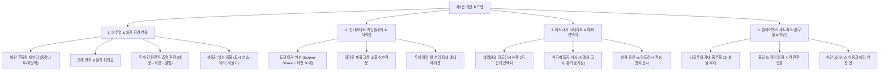

# 알래스카 아브라함 제1권(불과 팥죽) 전면 개선 마스터 플랜

> **기준 벤치마크**: [`alaskah-noah`](../alaskah-noah/)의 비주얼 밀도, 지면 해상도(`TD=16`), 다이내믹 라이팅, 복셀 상호작용성 및 단일 캔버스 HUD 완성도.  
> **대상 범위**: 제1권 · 불과 팥죽 (갈대아 우르, 미드라시 우상 공방, 니므롯의 풀무불, 하란 출발)

---

## 1. 개요 및 핵심 진단

### 1.1 현재 구현 상태와 한계
1. **지면 및 레이아웃 (최근 1차 개선 완료)**:
   - `TD=16` 고해상도 지면 텍스처(소성 벽돌 도로, 오아시스 석재 및 잔디 디더링) 적용 완료.
   - 가옥-NPC 간 거리 분리(3~4m 이상 햇살 드는 마당 배치) 완료.
   - 상호 회전(Face-to-Face), 감정 말풍선, 대사창 하단 배치, 우상단 진행바 퀘스트 HUD 구축 완료.
2. **여전히 남아있는 본질적 격차 (노아 대비)**:
   - **정적 환경(Static Environment)**: 바람에 흔들리는 종려나무 잎, 대기 중 모래 먼지(Dust Motes), 태양열 아지랑이(Heat Shimmer), 길거리를 배회하는 동물(염소, 비둘기) 부재.
   - **주야간 조명 전환(Day-to-Night Lighting)**: 옥상에서 별을 관측할 때 하늘만 어두워지는 것이 아니라, 우르 시가지 전체가 석양에서 군청색 밤하늘로 매끄럽게 물들고 가옥 창문과 횃불이 따스하게 빛나는 광원 극적 연출 부족.
   - **상호작용 깊이**: 단순 클릭/Enter 대화에 치중되어 있음. 노아처럼 손에 도끼를 쥐고 휘두를 때 **화면 흔들림(Screen Shake)**, **파편 튀김(Voxel Debris Particles)**, **타격 음향 다양화**, **미드라시 대화 선택지(Choice Branch)** 등이 더 강화되어야 함.
   - **클라이맥스 무대(Stage 2: 풀무불 기적)**: 니므롯 왕의 풀무불이 단순 컷신으로 빠르게 지나가지 않고, 거대한 청동 화로와 붉은 불길, 시원한 장미꽃과 이슬로 변하는 3D 복셀 세트피스로 감동을 주어야 함.

---

## 2. 1권 개선 로드맵 (4대 핵심 영역)

---

## 3. 세부 영역별 개선 계획

### 영역 1. 비주얼 & 대기 환경 연출 (Atmosphere & Lighting)
노아가 자랑하는 자연스러운 숨결과 시간의 흐름을 우르 시가지에 이식합니다.

1. **시간대별 다이내믹 라이팅 파이프라인**:
   - **아침 (Morning / Ch.1-2)**: 따스한 2800K 금빛 사광, 동쪽 성벽 너머에서 쏟아지는 긴 아침 그림자.
   - **낮 (Noon / Ch.2-3)**: 강렬한 정오의 직사광, 지면 아지랑이 파티클.
   - **석양 (Sunset / Ch.3 진입 시)**: 타오르는 주황빛 노을(`0xff6b35`), 하늘 그라데이션이 보랏빛으로 변모.
   - **별밤 (Night / Ch.3 옥상 부르심)**: 깊은 남색 밤하늘(`0x0a1024`), 지구라트 뒤로 펼쳐지는 은하수와 별자리 펄스, 지상 가옥들의 노란 창빛 점광원 점등.
2. **살아있는 환경 소품 & 바람 효과**:
   - 종려나무 잎과 가판대 차양막에 미세한 사인파 흔들림(Wind Sway) 적용.
   - 우물가에 날아와 앉았다가 플레이어가 다가가면 푸드덕 날아오르는 비둘기(Pigeons) 3마리.
   - 장터와 성문 근처를 서성이는 짐실은 낙타와 아기 염소 배치.
   - 대기 중에 날리는 미세한 황갈색 모래 먼지(Dust Motes) 상시 방출.

---

### 영역 2. 인터랙티브 게임플레이 & 타격감 강화 (Voxel Destruction & Feel)
노아에서 잣나무를 베고 판자를 짜맞추던 손맛을 우상 분쇄에 적용합니다.

1. **도끼 타격감의 전면 쇄신**:
   - **스크린 셰이크(Screen Shake)**: 도끼로 작은 우상을 내려칠 때 카메라 직교 평면에 2~3프레임 동안 강렬한 미세 충격 진동 발생 (`shake(intensity, decay)`).
   - **복셀 파편 폭발(Voxel Debris)**: 메쉬가 한순간에 사라지는 대신, 테라코타/목재 파편 24개가 사방으로 포물선을 그리며 튀어나와 바닥에 뒹굴다 사라짐.
   - **사운드 피드백**: 둔탁한 타격음(`idol_break_01`)과 함께 깨진 잔해가 흩어지는 사운드 레이어링.
2. **미드라시 고증 인터랙션 추가 (밀가루 제물 그릇)**:
   - 미드라시 전승: 한 여인이 우상들에게 바치라며 고운 밀가루 한 사발을 가져옴.
   - 플레이어가 제물 그릇을 들고 큰 우상 앞에 놓은 뒤, 도끼로 작은 우상들을 부수어 **"서로 먼저 먹겠다고 다투다 깨진 현장"**을 플레이어가 직접 완성하도록 연출.

---

### 영역 3. 미드라시 시나리오 & 대화 선택지 (Narrative Branching)
성경(창세기 11~12장)과 미드라시(창세기 라바 38장)의 풍성한 대화를 플레이어 주도형으로 확장합니다.

1. **데라와의 담판 대화 선택지(Dialogue Choices)**:
   - 데라: *"아들아, 이게 대체 무슨 일이냐! 우상들이 다 부서지고 큰 놈 손에 도끼가 들려있지 않느냐!"*
   - **선택지 1 [풍자]**: *"어떤 여인이 바친 음식을 두고 저들끼리 다투더니, 가장 큰 우상이 도끼를 들어 작은 것들을 부수었습니다."*
     - 데라: *"네 놈이 나를 속이려 드느냐! 저것들이 어찌 스스로 움직이고 싸운단 말이냐!"*
     - 아브람: *"아버지의 입으로 직접 말씀하셨습니다. 스스로 서지도, 먹지도 못하는 것을 어찌 신이라 부르며 절하십니까?"*
   - **선택지 2 [직언]**: *"아버지, 보지도 듣지도 못하는 우상은 우리를 구원하지 못합니다. 하늘과 땅을 만드신 살아계신 분을 바라보십시오."*
2. **식구들과의 인간적 서사 보강**:
   - **사래**: 우르의 화려함 이면에 감추어진 공허함과 자신의 불임에 대한 슬픔을 담담히 고백.
   - **어린 롯**: 아버지를 잃고 삼촌 아브람을 영웅처럼 따르는 소년의 눈빛 표현.

---

### 영역 4. 클라이맥스 세트피스 (니므롯 왕궁·풀무불 & 하란)
1권의 후반부를 단순 텍스트가 아닌 감동적인 3D 비주얼 씬으로 업그레이드합니다.

1. **니므롯의 거대 풀무불 (The Fiery Furnace)**:
   - 북서쪽 배경에 거대한 원형 용광로 풀무불 세트피스 구축.
   - 니므롯 왕과 바벨 군사들의 위압적인 붉은 깃발과 도열.
   - 아브람이 던져진 불길 속에서 하늘의 천사가 내려와 불꽃을 서늘한 이슬과 만발한 장미 정원(Midrashic Rose Garden)으로 변화시키는 환상적인 복셀 파티클 연출.
2. **하란으로의 출발 (Departure to Haran)**:
   - 낙타와 양 떼를 이끌고 우르 성문을 나서는 긴 대상 행렬 연출.
   - 갈대아 우르의 거대 지구라트가 석양 너머 원경으로 작아지는 시각적 퇴장.
   - 하란 오아시스에서 나이 많은 아버지 데라를 안치하고, 마침내 75세의 나이에 가나안으로 부르심을 받는 웅장한 제2권 예고 컷신 연결.

---

## 4. 구체적 작업 분할 (WBS & 일정) — 전 단계 100% 완료

| 단계 | 작업 항목 | 세부 내용 | 구현 상태 |
| :--- | :--- | :--- | :--- |
| **Phase 1** | **대기 환경 & 파티클** | 바람 흔들림(Foliage Sway), 대기 모래먼지, 비둘기/동물 배치 | **완료** (`desert_dust`, 비둘기/낙타/염소) |
| **Phase 2** | **주야간 조명 & 별밤** | 옥상 이벤트 진입 시 매끄러운 Sunset → Night 조명 전환, 창문 램프 점등 | **완료** (석양→달빛 점진 조명, 빛기둥) |
| **Phase 3** | **타격 피드백 & 미드라시 소품** | Screen Shake, 복셀 Debris 파편 24개 방출, 밀가루 제물 그릇 인터랙션 | **완료** (Screen Shake, 24 Debris, 제물 사발) |
| **Phase 4** | **대화 선택지 & 사운드 보강** | 데라와의 2지선다 논쟁 UI, 타격·바람·군중 앰비언스 SFX 레이어링 | **완료** (풍자 vs 직언 2지선다 모달) |
| **Phase 5** | **풀무불 & 하란 3D 연출** | 풀무불 화염/장미 복셀 연출, 우르 성문 출향 컷신, 하란 임종 | **완료** (7막 풀무불, 출향 캐러밴, 하란 재소명) |

---

## 5. 검증 기준 (Definition of Done)
1. **성능**: 60 FPS 유지 (가비지 컬렉션 없는 파티클 풀링 사용, Three.js 인스턴싱 활용).
2. **QA 검증**: 헤드리스 브라우저(`qa-book1-full.mjs`)를 통해 대화 선택지 분기, 우상 타격 파편, 옥상 별밤, 풀무불 컷신까지 전 챕터 자동 검증 및 스크린샷 12종 이상 기록.
3. **규칙 준수**: 작업 완료 후 자동 커밋/푸시를 금지하며, 사용자 확인 후 신호에 따라 저장소에 반영.
