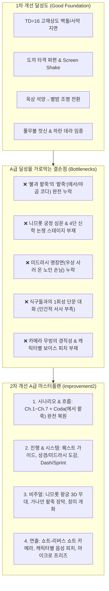
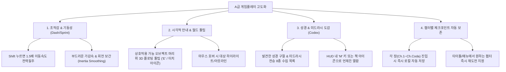
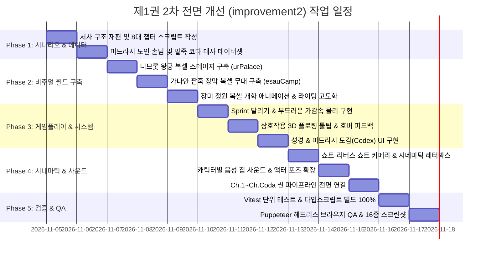

# 알래스카 아브라함 제1권(불과 팥죽) 2차 전면 개선 마스터 플랜 (improvement2)

> **핵심 목표**: 1차 개선(지면 해상도, Screen Shake, 옥상 조명 전환, 풀무불 컷신)을 바탕으로, **시나리오 및 서사 흐름, 게임플레이 진행, 비주얼 환경, 연출 및 사운드**의 전 영역을 상용 인디 명작 수준의 **A급(Class-A / AAA Benchmark)** 퀄리티로 완성한다.  
> **기준 벤치마크**: `alaskah-noah`의 완성도 + `A Short Hike` / `Eastward`의 감성적 조작감 및 월드 디테일 + 성경 및 미드라시(창세기 라바, 탈무드, 야샤르의 책)의 정통 고증.

---

## 1. 개요 및 1차 진단 (Current State vs A-Class Benchmark)

### 1.1 1차 개선의 성과와 한계
1. **성과**:
   - `TD=16` 픽셀 텍스처 파이프라인으로 지면 시각 밀도 대폭 향상.
   - 도끼 타격 시 24개 복셀 파편과 스크린 셰이크로 타격 손맛 확보.
   - 공방 옥상 부르심 및 풀무불 장미 정원 연출을 통한 기본 감정선 형성.
2. **한계 (A급을 위한 필연적 해결 과제)**:
   - **제목 '불과 팥죽'의 절반 결손**: 풀무불('불')은 구현되었으나, 왜 1권 제목이 '불과 팥죽'인지 알려주는 **에서와 붉은 팥죽('팥죽') 에필로그가 통째로 부재**.
   - **극적 대립 무대(니므롯 왕궁) 부재**: 아브람이 성문을 나서자마자 곧장 풀무불 화로로 워프하여, 바벨의 최고 권력자 니므롯 앞에서 펼쳐지는 탈무드/미드라시 4단계 신학 논쟁이 누락됨.
   - **미드라시 서사 깊이 부족**: 50세 노인 손님이 우상을 사러 왔다가 아브람의 일침에 부끄러워 돌아가는 유명한 우화가 없어, 아브람이 우상의 헛됨을 증명하는 전개가 다소 급작스러움.
   - **게임플레이 편의성**: 이동 속도가 단일하여 넓은 우르 거리를 걸을 때 답답함(Sprint 달리기 필요), 성경/미드라시 전승을 수집하고 확인하는 도감(Codex) UI 부재.
   - **연출과 음향의 디테일**: 캐릭터별 음성 칩 사운드(Typewriter Blip)가 구분되지 않아 몰입감 제한, 대화 컷신 시 정적 카메라 워크 탈피 필요.

---

## 2. 4대 핵심 영역별 A급 개선 상세 계획

---

### 영역 1. 시나리오 및 서사 흐름 전면 개선 (Narrative Architecture)

제1권 전체를 **7개 챕터 + 1개 코다(에필로그)**의 완결된 드라마틱 아크로 재편성합니다.

#### 1) Ch.1 프롤로그: 바벨과 갈대아 우르
- **내러티브 전환**: 바벨탑의 오만(니므롯의 등극) → 메소포타미아 평원과 거대 지구라트 → 데라의 우상 공방으로 부드러운 수직 하강 카메라 무빙.
- **주제 의식 선명화**: 인간의 힘으로 하늘에 닿으려는 거대한 제국(바벨)과, 그 제국의 중심에서 한 사람(아브람)을 부르시는 하나님의 거룩한 약속의 극명한 대비.

#### 2) Ch.2 우르의 아침과 데라의 공방 (미드라시 복원)
- **식구들과의 다면적 서사**:
  - **사래**: 불임의 고통과 갈대아 우르의 화려한 풍요 속에서 느끼는 영혼의 갈증을 아브람에게 토로.
  - **어린 롯**: 일찍 아버지를 여의고 삼촌 아브람을 영웅처럼 따르며 바깥세상에 대한 호기심을 반짝임.
  - **아버지 데라**: 우르 왕실 공방의 장인으로서의 자부심과 생계, 그리고 맏아들 아브람의 남다른 눈빛에 대한 막연한 불안.
- **미드라시 명장면: 우상을 사러 온 50세 노인 손님 (신규 인터랙티브 퀘스트)**:
  - 공방 앞마당에 50세 노인 손님이 찾아와 집안을 지켜줄 우상을 요구함.
  - 아브람과 손님의 대화 선택지:
    - 아브람: *"어르신, 연세가 어떻게 되십니까?"*
    - 손님: *"쉰 살이오."*
    - 아브람: *"쉰 살이나 되신 어르신께서, 어제 제 아버지가 진흙으로 빚은 하루살이 조각상에 머리를 조아리고 복을 빌려 하십니까?"*
  - 손님이 크게 부끄러워하며 우상을 사지 않고 빈손으로 돌아서는 미드라시 창세기 라바 38장의 백미를 직접 플레이.

#### 3) Ch.3 별밤의 고뇌와 첫 부르심
- **우르의 달신 '신(Nanna)' 숭배와의 대비**:
  - 옥상 테라스에서 우르 도시 전체가 달신 난나를 찬양하는 등불을 바라보며 아브람의 깊은 실존적 성찰.
  - *"저 끝없는 은하수와 별들을 지으신 분이 계실 텐데, 어찌 피조물을 신이라 부르는가..."*
- **황금빛 빛기둥(Beam)과 거룩한 음성**:
  - 석양에서 남색 밤하늘로의 자연스러운 조명 전환.
  - 사도행전 7:2-3의 장엄한 영광의 임재와 금빛 자막 (`style: 'voice'`).

#### 4) Ch.4 도끼와 우상 분쇄 (미드라시 현장 퍼즐)
- **제물 사발과 도끼의 인과 관계 완성**:
  - 어떤 여인이 우상들에게 바치라며 고운 밀가루 한 사발을 가져옴.
  - 아브람이 가장 큰 우상 발치에 제물 사발을 바침.
  - 작업대에서 청동 도끼를 쥐고 작은 우상 3개를 차례로 강타 분쇄.
  - 가장 큰 우상의 손에 도끼를 꽂아 **"음식을 두고 서로 먼저 먹겠다고 다투다 큰 우상이 작은 것들을 때려부순 현장"**을 위장.
- **데라와의 2단계 명논쟁 문답**:
  - 선택지 1 [미드라시 풍자]: *"제물을 두고 다투더니 저 큰 신상이 도끼로 다 부수었습니다."* → 데라: *"저것들이 어찌 움직인단 말이냐!"* → 아브람: *"어찌 움직이지도 못하는 것을 신이라 부르십니까?"*
  - 선택지 2 [성경적 직언]: 우상의 허망함과 살아계신 창조주 하나님을 담대히 선포.

#### 5) Ch.5 니므롯의 궁정과 신학 재판 (★ 신규 무대 및 완전 구현)
- **압송과 바벨 왕궁 진입**:
  - 공방 성문을 통과하면 곧장 풀무불로 가지 않고, **니므롯의 웅장한 이슈타르 청유리 궁정(`ur_palace`)**으로 연행.
  - 근위병과 제사장들이 도열한 가운데 황금 옥좌의 니므롯 왕 대면.
- **탈무드/미드라시 4단계 신학 논쟁 (인터랙티브 선택지 시스템)**:
  - 니므롯: *"갈대아의 신들을 모독한 자여, 불을 섬기라!"*
  - **선택 1**: *"불을 꺼뜨리는 물을 섬기오리까?"*
  - 니므롯: *"그렇다면 물을 섬기라!"*
  - **선택 2**: *"물을 품어 나르는 구름을 섬기오리까?"*
  - 니므롯: *"그렇다면 구름을 섬기라!"*
  - **선택 3**: *"구름을 흩뜨려 버리는 바람을 섬기오리까?"*
  - 니므롯: *"그렇다면 바람을 섬기라!"*
  - **선택 4**: *"바람을 견디며 살아가는 사람을 섬기오리까? 오직 천지만물을 지으신 여호와 하나님만이 참신이십니다!"*
- **니므롯의 격노**:
  - 논리에 완전히 밀려 분노한 니므롯이 옥좌에서 벌떡 일어나 풀무불 투옥을 선언.

#### 6) Ch.6 풀무불의 기적과 장미꽃 동산
- **가마 투척과 천사의 강림**:
  - 칠 배나 뜨거운 가마에 결박되어 던져진 아브람.
  - 하늘에서 내려온 천사가 밧줄만을 사르고, 불길 속에서 아브람의 옷자락 하나 상하지 않음.
- **장미꽃 동산(Rose Garden) 복셀 개화 기적 (창세기 라바 38:13 / 탈무드 페사힘 118a)**:
  - 천사의 손짓과 함께 붉은 화염이 시원한 아침 이슬로 바뀌고, 바닥의 숯불이 붉은 장미꽃과 시냇물로 피어남.
  - 아브람과 천사가 장미꽃 사이를 유유히 거님.
  - 니므롯이 경악하여 황금 홀을 떨어뜨리며 *"넷째의 모습은 신들의 아들과 같도다"* 고백.

#### 7) Ch.7 우르 출향과 하란의 안식
- **낙타 대상 행렬의 출향**:
  - 가축과 짐을 챙겨 우르 성문을 나서는 긴 대상 행렬 연출.
  - 석양 너머로 아득해지는 우르의 거대 지구라트 실루엣.
- **하란 오아시스와 데라의 임종**:
  - 하란 장막에서 205세로 평안히 눈을 감는 아버지 데라의 유언 (*"네가 만난 살아계신 하나님을 결코 놓치지 말아라"*).
  - 돌무덤 애도 후, 75세 아브람에게 임하는 창세기 12:1-3 대소명 선포 (*"너는 복이 될지라"*).

#### 8) Ch.Coda 에필로그: 에서와 붉은 팥죽 (★ 신규 무대 및 완전 구현)
- **1권의 수수께끼 완결 ('불과 팥죽'의 완성)**:
  - [시대 전환: 먼 훗날 가나안 장막]
  - **주인공 전환**: 플레이어는 사냥에 지쳐 굶주린 청년 **에서(Esau)**로 직접 조작.
  - 들판을 지나 야곱의 장막으로 비틀거리며 걸어옴.
  - 모닥불 위 청동 솥에서 붉은 렌즈콩 팥죽을 끓이고 있는 동생 야곱과 상호작용.
- **장자권 매매의 비극적 선택**:
  - 야곱: *"형의 장자의 명분을 오늘 내게 팔라."*
  - 에서의 고뇌와 선택지:
    - *"내가 지금 굶어 죽게 되었으니, 이 장자권이 내게 무슨 유익이 있으리요!"*
  - 맹세 후 건네받은 팥죽 한 그릇을 먹고 일어서는 에서의 뒷모습.
  - 내레이션: *"아브라함의 하나님을 가벼이 여긴 자와 언약을 사모한 자의 갈림길. 제1권 [불과 팥죽]의 대단원."*

---

### 영역 2. 진행 및 게임플레이 전면 개선 (Progression & Game Feel)

1. **조작감 및 기동성 (Fluid Movement & Sprint)**:
   - **달리기 기능(Sprint)**: `Shift` 키 누름 또는 모바일 가상 패드 외곽 드래그 시 이동속도 1.5배(4.2 → 6.3) 가속.
   - **부드러운 가감속(Inertia Smoothing)**: 즉시 정지하는 뚝뚝 끊김 없이 2~3프레임 동안 부드럽게 감속하는 물리감 부여.
2. **시각적 상호작용 피드백 (Floating Prompt & Hover)**:
   - 상호작용 범위(1.8m) 진입 시, 대상의 머리 위에 깔끔한 픽셀풍 `[E] 대화` 또는 `[E] 살펴보기` 플로팅 버블 표시.
   - 마우스 커서 호버 시 클릭 가능 여부를 커서 모양과 외곽선으로 명확히 전달.
3. **성경 & 미드라시 도감 시스템 (Biblical Lore Codex)**:
   - 게임을 진행하며 해금되는 8대 전승 기록 카드:
     1. *바벨탑과 니므롯의 저주 (창세기 10~11장)*
     2. *데라의 공방과 50세 노인 손님 (창세기 라바 38:13)*
     3. *우르의 밤하늘과 첫 부르심 (사도행전 7:2-3)*
     4. *도끼와 부서진 우상들의 침묵 (창세기 라바 38:13)*
     5. *니므롯 왕 앞에서의 4단 변증 (창세기 라바 38:13)*
     6. *풀무불의 기적과 장미꽃 동산 (탈무드 페사힘 118a)*
     7. *하란의 안식과 75세의 대소명 (창세기 12:1-3)*
     8. *에서와 붉은 팥죽 한 그릇 (창세기 25:29-34 / 탈무드 바바 바트라 16b)*
   - HUD 우상단 책 아이콘 또는 `C` 키로 도감 창을 열람하여 성서 인문학적 배경지식을 즐길 수 있음.
4. **타격감(Juice)의 극대화**:
   - 우상 타격 시 0.08초 마이크로 프리즈(Hit-stop) 적용으로 손맛 강화.
   - 돌 파편 24개가 충격 방향의 반대편으로 포물선을 그리며 바닥에 튕기는 물리감 보강.

---

### 영역 3. 비주얼 및 환경 전면 개선 (Visuals & 3D Sets)

1. **신규 3D 복셀 스테이지 전면 구축**:
   - **스테이지 A: 니므롯 왕궁 (`world/stages/urPalace.ts`)**:
     - 기존 단색 임시 박스를 전면 철거.
     - 이슈타르 블루(`0x1d4e89`) 유약 벽돌 벽면과 황금 사자 부조.
     - 8개의 웅장한 대리석 기둥 회랑과 천장 차양막.
     - 3단 계단식 황금 옥좌와 자주색 왕실 벨벳 카펫.
     - 테라스 너머로 보이는 거대 지구라트와 바벨의 스카이라인.
     - 타오르는 청동 향로 불꽃 및 은은한 실내 조명(Point Light).
   - **스테이지 B: 가나안 팥죽 장막 (`world/stages/esauCamp.ts`)**:
     - 가나안 헤브론 구릉지 대지(바람에 흔들리는 풀과 붉은 황토).
     - 펄럭이는 유목민 장막 2채.
     - 야외 모닥불 삼각대 위에 걸린 청동 솥 복셀 메쉬.
     - 청동 솥 안에서 보글보글 끓어오르는 붉은 렌즈콩 팥죽 복셀 텍스처와 피어오르는 김(Steam) 파티클.
     - 사냥용 활, 화살통, 사냥감 털가죽 소품 배치.
2. **24시간 다이내믹 라이팅 파이프라인 (Smooth TOD Transition)**:
   - 옥상 이벤트 시 단색 즉시 점프가 아닌, 3초 동안 서서히 전환되는 앰비언트/디렉셔널 라이트 보간:
     - **Morning (07:00)**: 2800K 금빛 사광, 긴 아침 그림자, 청명한 푸른 하늘 (`0x8cc8e8`).
     - **Noon (12:00)**: 5500K 백금 직사광, 지면 아지랑이 파티클.
     - **Sunset (18:30)**: 깊은 주황-보랏빛 하늘 (`0x76384a`), 황금빛 노을빛 (`0xff6e32`).
     - **Night (22:00)**: 군청색 밤하늘 (`0x0a1024`), 푸른 달빛 (`0x4a629e`), 옥상 횃불 점등, 별무리 파티클 펄스.
     - **Dawn (05:30)**: 복숭아빛 여명 (`0xd0e8f8`).
3. **풀무불 장미꽃 동산 점진적 개화 애니메이션 (Voxel Blooming)**:
   - 천사가 내려와 손을 뻗을 때, 메쉬가 갑자기 나타나는 대신 복셀 잔디와 장미 덤불이 바닥에서 `scale.y` 0에서 1로 부드럽게 솟아오르는 개화 애니메이션 구현.
   - 영롱한 아침 이슬 물방울과 흩날리는 장미 꽃잎 파티클 50개 방출.

---

### 영역 4. 연출 및 사운드 전면 개선 (Cinematic Direction & Audio)

1. **시네마틱 카메라 안무 (Camera Choreography)**:
   - **쇼트-리버스 쇼트(Shot-Reverse Shot)**:
     - 니므롯과 아브람의 왕궁 대면: 니므롯을 로우 앵글(위압감)로 비춘 후, 굴복하지 않는 아브람의 결연한 정면 클로즈업으로 전환.
     - 데라와의 공방 담판: 망연자실한 데라의 얼굴과 확신에 찬 아브람의 대조.
     - 야곱과 에서의 팥죽 거래: 탈진하여 쓰러진 에서의 오버더숄더(Over-the-Shoulder) 뷰와 솥을 젓는 야곱의 시선 교차.
   - **시네마틱 레터박스 & 챕터 타이틀 카드**:
     - 주요 컷신 돌입 시 화면 상하에 부드러운 검은색 레터박스 바 생성.
     - 골드 엠보싱 챕터 명칭과 성경 인용 자막 표출.
2. **캐릭터 액터 포즈 & 이모트 확장**:
   - 감정 버블: 기존 4종에서 `!` (느낌표), `?` (물음표), `...` (침묵), `anger` (분노), `sweat` (식은땀), `heart` (감사/사랑), `panic` (당황/경악), `pray` (기도), `resolve` (결의) 9종으로 확장.
   - 액터 3D 복셀 포즈:
     - `swingAxe`: 도끼 양손 쥐고 내리치기
     - `throneStand`: 옥좌에서 분노로 벌떡 일어서기
     - `pointAccuse`: 삿대질하며 사형 선고
     - `stirPot`: 국자로 팥죽 솥 젓기
     - `faintHunger`: 배고픔에 비틀거리며 무릎 꿇기
3. **A급 사운드스케이프 (Audio Design & Voice Blips)**:
   - **캐릭터별 대화 음성 칩 사운드(Typewriter Voice Pitch)**:
     - 자막이 타이핑될 때 캐릭터의 성격에 맞춘 고유 주파수의 오디오 블립(Blip) 재생:
       - **아브람**: 묵직하고 신뢰감 있는 중저음 톤 (320Hz)
       - **데라**: 거칠고 갈라지는 노인의 저음 톤 (210Hz)
       - **니므롯**: 웅장하고 반향이 큰 위압적 톤 (160Hz)
       - **사래**: 부드럽고 차분한 고음 톤 (480Hz)
       - **어린 롯**: 맑고 통통 튀는 소년 톤 (580Hz)
       - **야곱**: 차분하고 냉철한 지략가의 톤 (360Hz)
       - **에서**: 거칠고 숨찬 사냥꾼의 중음 톤 (280Hz)
       - **하나님의 음성**: 거룩한 리버브가 깃든 성스러운 울림
   - **BGM 크로스페이드**: 씬 전환 시 급작스런 음악 끊김을 방지하고 1.5초간 볼륨 페이드아웃/페이드인 교차.
   - **효과음 레이어링**: 팥죽 끓는 보글보글 소리, 궁정의 웅장한 대리석 발소리 반향, 풀무불의 위협적인 저음 럼블.

---

## 3. 구체적 작업 분할 (WBS & Roadmap)

| 단계 | 작업 항목 | 대상 파일 및 모듈 | 핵심 구현 내용 |
| :--- | :--- | :--- | :--- |
| **Phase 1** | **시나리오 & 데이터 정립** | `src/data/books/abraham_1.json` `src/systems/story.ts` | - Ch.1~Ch.7 + Coda(에서와 팥죽) 8대 챕터 정립 - 노인 손님 미드라시, 니므롯 4단 변증, 팥죽 거래 텍스트 완성 |
| **Phase 2** | **3D 복셀 무대 구축** | `src/world/stages/urPalace.ts` `src/world/stages/esauCamp.ts` `src/world/stageManager.ts` | - 니므롯 왕궁: 이슈타르 블루 타일, 황금 옥좌, 대리석 회랑 - 팥죽 장막: 끓는 팥죽 솥 복셀, 스팀 파티클, 가나안 들판 - 장미 정원 점진적 개화 애니메이션(`scale.y` 보간) |
| **Phase 3** | **게임플레이 & 시스템** | `src/entities/player.ts` `src/ui/hud.ts` `src/game/input.ts` | - Shift 달리기(Sprint 1.5배) & Inertia 가감속 - 머리 위 3D 플로팅 상호작용 툴팁 & 마우스 호버 아웃라인 - 성경/미드라시 8대 전승 도감(Codex) UI 및 단축키 |
| **Phase 4** | **시네마틱 & 사운드** | `src/systems/scenes/book1/` `src/entities/actor.ts` `src/audio/audioManager.ts` | - 쇼트-리버스 쇼트 카메라 앵글 & 시네마틱 레터박스 - 캐릭터별 음성 칩(Blip) 주파수 차별화 (아브람/데라/니므롯/에서) - 액터 포즈 5종 확장 & 감정 버블 9종 완비 |
| **Phase 5** | **통합 QA & 검증** | `tests/` `docs/qa/qa-book1-improvement2.mjs` | - Vitest 12개 테스트 파일 100% 통과 유지 - 헤드리스 브라우저 자동 플레이로 전 챕터 스크린샷 16종 기록 - 60 FPS 유지 및 메모리 누수 제로 검증 |

---

## 4. 최종 검증 기준 (Definition of Done)

1. **내러티브 완결성**:
   - Ch.1 프롤로그부터 Ch.7 하란 정착, 그리고 Coda 에서의 붉은 팥죽까지 **단 하나의 건너뜀 없이 플레이어블과 시네마틱이 매끄럽게 연결**되어야 함.
   - 1권 제목 '불과 팥죽'의 두 기둥(니므롯의 불 vs 에서의 팥죽)이 완벽히 결합되어야 함.
2. **시각 및 연출 밀도**:
   - 니므롯 왕궁과 에사우 장막이 노아의 마을에 필적하는 고밀도 3D 복셀 지오메트리로 표현되어야 함.
   - 대화 시 캐릭터별 음성 피치와 감정 표현, 역동적인 카메라 쇼트 전환이 자연스럽게 작동해야 함.
3. **조작감 및 편의성**:
   - 달리기(Sprint), 상호작용 플로팅 툴팁, 성경/미드라시 도감(Codex)이 쾌적하게 구동되어야 함.
4. **품질 및 성능 지표**:
   - `npm test` (Vitest) 100% 통과.
   - `npm run build` (`tsc --noEmit && vite build`) 무오류 통과.
   - 60 FPS 프레임 드랍 없는 파티클 및 메시 렌더링 유지.
5. **운영 규칙 준수**:
   - 작업 완료 후 사용자의 명시적 지시가 있을 때까지 **자동 git commit / push / deploy 금지**.